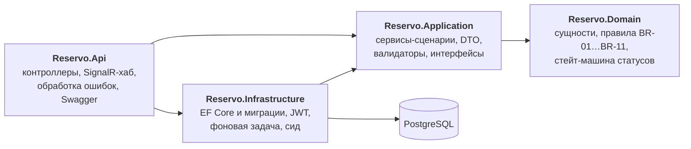
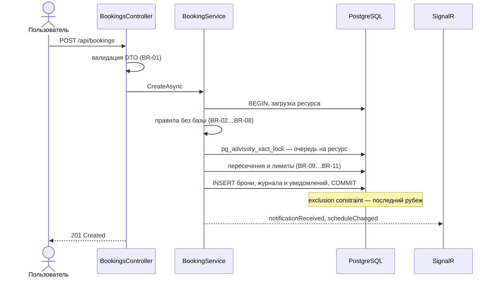
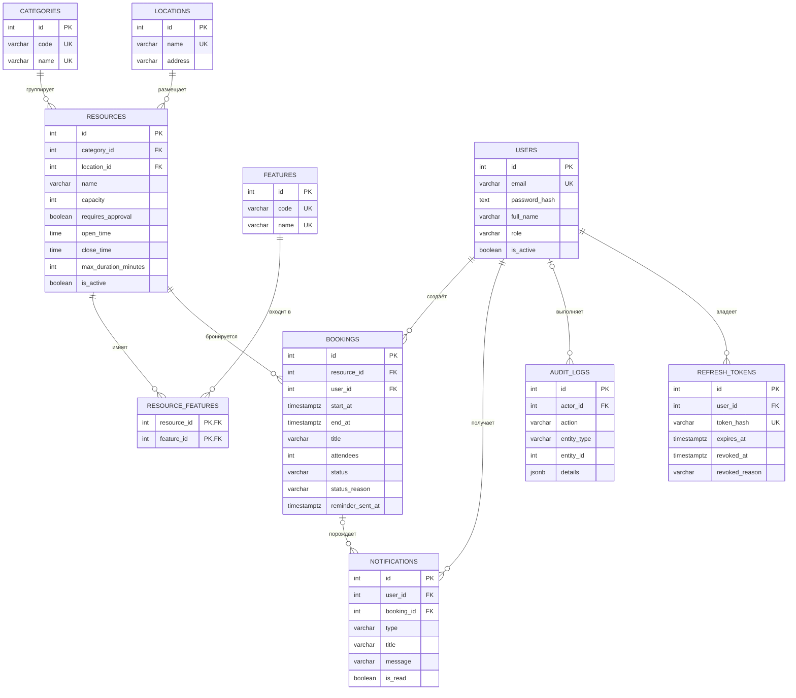

# Reservo

[](https://github.com/vi5vi5vi5/Reservo/actions/workflows/ci.yml)


[](LICENSE)

Система бронирования ресурсов университета: аудиторий, переговорных, лабораторий и оборудования.
REST API на ASP.NET Core, через который студенты и сотрудники находят свободные ресурсы и бронируют их,
не пересекаясь по времени.

Главное в проекте — гарантия: **два человека никогда не займут один ресурс на одно и то же время**,
даже если запросы пришли в одну и ту же миллисекунду. Вторая опора — асинхронность: фоновые задачи
и живые обновления через SignalR.

> Учебный проект по курсу «Программирование на C#» (кейс 6.1 «Система бронирования ресурсов»).

## Содержание

- [Возможности](#возможности)
- [Защита от двойных броней](#защита-от-двойных-броней)
- [Технологии](#технологии)
- [Архитектура](#архитектура)
- [Модель данных](#модель-данных)
- [Быстрый старт](#быстрый-старт)
- [Демо-аккаунты](#демо-аккаунты)
- [Как посмотреть в работе](#как-посмотреть-в-работе)
- [API](#api)
- [Тесты](#тесты)
- [Развёртывание на сервере](#развёртывание-на-сервере)
- [Принятые решения](#принятые-решения)

## Возможности

- **Регистрация и вход**: JWT access-токен и refresh-токен с ротацией и защитой от повторного использования. Роли `User` и `Admin`.
- **Каталог**: ресурсы с категориями, корпусами и оснащением; фильтры, текстовый поиск, сортировка, пагинация.
- **Поиск свободных ресурсов** на интервал: «переговорная на 8 человек с проектором, завтра 14:00–15:30».
- **Расписание ресурса** за день или неделю. Чужие брони видны как занятое время, без владельца и темы.
- **Бронирование**: создание, перенос, отмена. 18 бизнес-правил: сетка 15 минут, рабочие часы, вместимость,
  лимиты длительности и числа броней, отсутствие пересечений.
- **Согласование**: брони ресурсов с флагом «требует согласования» ждут решения администратора.
- **Журнал операций**: история каждой брони для пользователя и общий журнал для администратора.
- **Уведомления**: хранятся в базе и приходят мгновенно через SignalR; расписание обновляется у всех, кто на него смотрит.
- **Фоновая задача**: напоминания перед началом брони, автозавершение прошедших и автоотклонение несогласованных броней.
- **Администрирование**: управление каталогом, деактивация ресурса с отменой его будущих броней, блокировка пользователей и смена ролей.

## Защита от двойных броней

Пересечение интервалов — классическая гонка: два запроса одновременно проверяют «свободно ли?», оба видят «да»
и оба записывают бронь. Reservo закрывает её в три слоя.

1. **Правила в коде** (`Reservo.Domain`) дают понятную ошибку `409 booking.time_conflict`:
   «Переговорная «Онега»: занято 25 октября с 14:00 до 15:30».
2. **Очередь на ресурс.** Перед проверкой пересечений транзакция берёт блокировку PostgreSQL
   `pg_advisory_xact_lock(1, resource_id)`. Одновременные брони одного ресурса проходят проверку по одной,
   и каждая видит уже сохранённые. Брони разных ресурсов друг другу не мешают.
3. **Exclusion constraint в базе** — последний рубеж. Физически не даёт записать пересекающиеся активные брони,
   даже если запись пришла в обход API:

   ```sql
   ALTER TABLE bookings ADD CONSTRAINT ex_bookings_no_overlap
     EXCLUDE USING gist (resource_id WITH =, tstzrange(start_at, end_at, '[)') WITH &&)
     WHERE (status IN ('Pending', 'Confirmed'));
   ```

Интервалы полуоткрытые: `[start, end)`, поэтому брони 10:00–11:00 и 11:00–12:00 не конфликтуют.
Интеграционный тест отправляет 10 одновременных запросов на один слот и проверяет итог: ровно один `201 Created`
и девять `409 booking.time_conflict`.

## Технологии

| Назначение | Технология |
|---|---|
| Платформа | .NET 10, C# 14 |
| Веб | ASP.NET Core Web API (контроллеры), SignalR |
| Данные | Entity Framework Core 10, Npgsql, PostgreSQL 18 |
| Безопасность | JWT Bearer, `PasswordHasher` (PBKDF2), refresh-токены (в базе хранится только SHA-256) |
| Валидация и ошибки | FluentValidation, ProblemDetails (RFC 9457) с машиночитаемым кодом ошибки |
| Логирование | Serilog: консоль и файлы с ротацией |
| Документация | Swagger UI (Swashbuckle) с XML-комментариями и авторизацией по JWT |
| Тесты | xUnit v3, WebApplicationFactory, Testcontainers (настоящий PostgreSQL в Docker), FakeTimeProvider |
| Инфраструктура | Docker, Docker Compose, GitHub Actions, GitHub Container Registry |

## Архитектура

Четыре проекта со строгими зависимостями: бизнес-правила ничего не знают ни о базе, ни о HTTP.



- **Domain** — чистая логика без зависимостей: что такое бронь, какие правила, какие переходы статусов. Правила —
  чистые функции, поэтому каждое покрыто unit-тестами.
- **Application** описывает сценарии и интерфейсы (`IAppDbContext`, `ITokenService`, `IRealtimeNotifier`).
  Ошибки бизнес-логики — `AppException` с кодом; какой HTTP-статус ему соответствует, решает только слой Api.
- **Infrastructure** реализует интерфейсы: `AppDbContext`, JWT, хеширование паролей, фоновую задачу.
  Нарушения ограничений базы переводятся в те же ошибки, что выбросил бы код.
- **Api** собирает всё вместе и принимает HTTP-запросы и WebSocket-подключения.

Как проходит создание брони:



Структура репозитория:

```
src/
  Reservo.Domain/            сущности, перечисления, бизнес-правила, стейт-машина
  Reservo.Application/       сервисы, DTO, валидаторы, интерфейсы, коды ошибок
  Reservo.Infrastructure/    EF Core (контекст, конфигурации, миграции, сид), JWT, фоновая задача
  Reservo.Api/               контроллеры, SignalR-хаб, обработчики ошибок, Swagger, демо-страница
tests/
  Reservo.UnitTests/         правила, стейт-машина, валидаторы, логика фоновой задачи
  Reservo.IntegrationTests/  API целиком + PostgreSQL в Testcontainers
requests/                    .http-файлы с демо-сценариями
```

## Модель данных



Время хранится в UTC (`timestamptz`), рабочие часы ресурсов — в местном времени площадки (Europe/Moscow).
Статусы брони: `Pending` → `Confirmed` → `Completed`, а также конечные `Rejected` и `Cancelled`.
Активные брони (`Pending`, `Confirmed`) занимают время, остальные нет.

## Быстрый старт

Нужны [Docker](https://www.docker.com/) и, для разработки, [.NET 10 SDK](https://dotnet.microsoft.com/download).

### Всё в Docker

```bash
git clone https://github.com/vi5vi5vi5/Reservo.git
cd Reservo
cp .env.example .env
```

В `.env` задайте `JWT_KEY` (не короче 32 символов, например `openssl rand -base64 48`), `ADMIN_PASSWORD`
и `DEMO_USER_PASSWORD`. Затем:

```bash
docker compose up -d --build
```

- Swagger: <http://localhost:8080/swagger>
- Живые обновления: <http://localhost:8080/demo/>
- Проверка состояния: <http://localhost:8080/health>

При первом запуске API сам применит миграции и добавит демо-данные: каталог из 15 ресурсов, администратора,
трёх демо-пользователей и несколько броней на завтра и послезавтра.

### Разработка в Visual Studio

1. Поднять только базу (PostgreSQL слушает `127.0.0.1:5433`, `.env` не нужен):
   ```bash
   docker compose up -d db
   ```
2. Открыть `Reservo.slnx` в Visual Studio 2026 и запустить `Reservo.Api` (F5, профиль `https`).
   Откроется Swagger: <https://localhost:7233/swagger>.

Или из терминала: `dotnet run --project src/Reservo.Api --launch-profile https`.

Новая миграция (инструмент `dotnet-ef` подключён локально, после клонирования один раз нужен `dotnet tool restore`):

```bash
dotnet ef migrations add <Name> -p src/Reservo.Infrastructure -s src/Reservo.Api -o Persistence/Migrations
```

## Демо-аккаунты

| Роль | Email | Пароль локально |
|---|---|---|
| Администратор | `admin@reservo.example` | `Admin12345` |
| Студент | `student@reservo.example` | `Demo12345` |
| Студент | `student2@reservo.example` | `Demo12345` |
| Преподаватель | `teacher@reservo.example` | `Demo12345` |

Пароли из таблицы действуют при запуске из Visual Studio (`appsettings.Development.json`). В Docker пароли задаются
в `.env` (`ADMIN_PASSWORD`, `DEMO_USER_PASSWORD`).

## Как посмотреть в работе

- **Swagger UI** (`/swagger`): войдите через `POST /api/auth/login`, скопируйте `accessToken`, нажмите **Authorize**.
- **[`requests/demo.http`](requests/demo.http)** — сценарий демонстрации по шагам: поиск свободной переговорной,
  бронь, конфликт `409`, перенос и история, согласование, деактивация ресурса, журнал. Запросы отправляются прямо
  из редактора Visual Studio, адрес и пароли для разных окружений — в [`requests/http-client.env.json`](requests/http-client.env.json).
- **[`requests/api-tour.http`](requests/api-tour.http)** — остальное: регистрация, сессии и refresh-токены,
  ошибки `401`/`403`/`404`/`400`, каталог, уведомления, блокировка пользователей.
- **Демо-страница `/demo/`** — живые обновления без фронтенда. Откройте её в двух окнах и войдите разными
  пользователями: бронь в одном окне сразу появляется в расписании другого, а действия администратора приходят
  уведомлением.

## API

Базовый путь `/api`, JSON в camelCase, даты в ISO 8601 со смещением. Полная документация — в Swagger.

| Область | Эндпоинты |
|---|---|
| Аутентификация | `POST /auth/register`, `/auth/login`, `/auth/refresh`, `/auth/logout`, `GET /users/me` |
| Каталог | `GET /resources` (фильтры, поиск, сортировка, пагинация), `/resources/{id}`, `/resources/available`, `/resources/{id}/schedule`, справочники `/categories`, `/locations`, `/features` |
| Брони | `POST /bookings`, `GET /bookings/my`, `GET` и `PUT /bookings/{id}`, `POST /bookings/{id}/cancel`, `GET /bookings/{id}/history` |
| Уведомления | `GET /notifications`, `/notifications/unread-count`, `POST /notifications/{id}/read`, `/notifications/read-all` |
| Администратор | CRUD каталога, `POST /resources/{id}/deactivate` и `/activate`, `GET /admin/bookings`, `POST /admin/bookings/{id}/approve` и `/reject`, `GET /admin/audit`, `GET /admin/users`, `PUT /admin/users/{id}/role`, `POST /admin/users/{id}/block` и `/unblock` |
| Живые обновления | SignalR-хаб `/hubs/live`: события `notificationReceived` и `scheduleChanged`, методы `SubscribeToResource` и `UnsubscribeFromResource` |
| Служебное | `GET /health`, `/swagger` |

Всё закрыто по умолчанию: эндпоинт доступен без входа, только если явно помечен `[AllowAnonymous]`.
Ошибки приходят в формате ProblemDetails с полем `code`, на которое опирается клиент:

```json
{
  "title": "Ресурс уже занят на это время.",
  "status": 409,
  "detail": "Переговорная «Онега»: занято 25 октября с 14:00 до 15:30.",
  "code": "booking.time_conflict",
  "traceId": "00-79f83d11ae554a4b6e14255245d3d4ce-692c79d47a4f45a1-00"
}
```

## Тесты

```bash
dotnet test
```

Интеграционным тестам нужен запущенный Docker: они поднимают одноразовый PostgreSQL через Testcontainers.

- **Unit-тесты** (`Reservo.UnitTests`): граничные значения каждого бизнес-правила, стейт-машина статусов,
  валидаторы, решения фоновой задачи.
- **Интеграционные тесты** (`Reservo.IntegrationTests`): API целиком по HTTP — регистрация и вход, коды `401`/`403`/`404`,
  конфликт броней и **гонка из 10 параллельных запросов**, поиск свободных ресурсов, согласование с уведомлениями,
  деактивация ресурса, живое уведомление через SignalR, фоновая задача с поддельными часами.

GitHub Actions прогоняет все тесты на каждый push и pull request.

## Развёртывание на сервере

GitHub Actions после зелёных тестов в `main` собирает Docker-образ и публикует его в GitHub Container Registry
(`ghcr.io/vi5vi5vi5/reservo-api`) с тегами `latest` и `sha-<коммит>`. Сервер только скачивает готовый образ.

```bash
git clone https://github.com/vi5vi5vi5/Reservo.git
cd Reservo
cp .env.example .env    # задать POSTGRES_PASSWORD, JWT_KEY, ADMIN_PASSWORD, DEMO_USER_PASSWORD, API_BIND=0.0.0.0
docker compose pull api
docker compose up -d
```

Обновление до свежей сборки — те же две команды: `docker compose pull api && docker compose up -d`.
Откат — `API_TAG=sha-<коммит>` в `.env` и снова `docker compose up -d`.

- Порт API задаётся в `.env` (`API_PORT`, по умолчанию 8080). База наружу не открывается.
- Docker публикует порты в обход `ufw`: открытый порт доступен из интернета, даже если firewall его не разрешает.
- Контейнерам выставлены лимиты памяти, а журналам Docker — ротация, чтобы не перегружать небольшой сервер.

## Принятые решения

| Решение | Почему |
|---|---|
| PostgreSQL, а не SQLite | Exclusion constraint, `tstzrange` и `timestamptz` есть только в PostgreSQL; SQLite допускает одного пишущего |
| Очередь на ресурс (advisory lock) перед проверкой | Без неё одновременные брони сталкиваются уже на exclusion constraint и PostgreSQL прерывает их как взаимоблокировку |
| Бизнес-правила — чистые функции в Domain | Каждое правило тестируется без базы и без HTTP |
| Сервисы работают с `DbContext` напрямую, без репозиториев | `DbContext` уже реализует Unit of Work и репозиторий; лишний слой не нужен |
| Без AutoMapper и MediatR | Ручной маппинг прозрачнее; у обеих библиотек теперь коммерческие лицензии |
| Ошибки — `AppException` с кодом, HTTP-статус выбирает Api | Слой Application не знает про HTTP; клиент опирается на стабильный `code` |
| Дубли и удаление используемых записей проверяет база | Уникальный индекс и внешний ключ надёжнее предварительного запроса: нет гонок |
| Время в UTC, рабочие часы в местном времени площадки | Сравнения однозначны; в местное время переводим только для проверки рабочих часов и текстов |
| Ключи `int`, перечисления строками, имена в snake_case | Удобно в демо и читаемо в базе |
| Мягкое удаление ресурсов и блокировка пользователей | История броней и журнал не теряются |
| `TimeProvider` вместо `DateTime.Now` | В тестах время подменяется, фоновая задача проверяется без ожидания |
| Миграции и сид при старте | Осознанное упрощение учебного проекта: стенд поднимается одной командой |

## Лицензия

[MIT](LICENSE)
